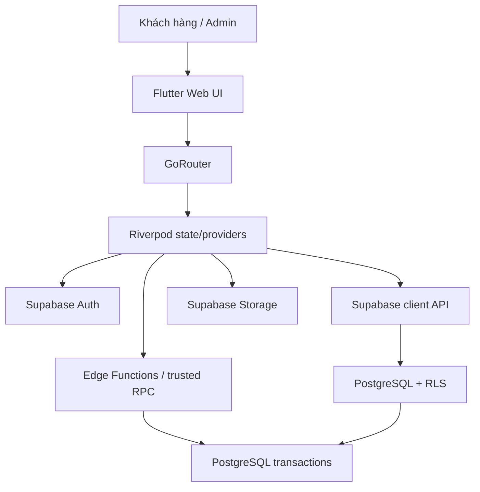

# 7. Kiến trúc hệ thống

## 7.1 Tổng quan

## 7.2 Trách nhiệm thành phần
### Flutter Web
- Render giao diện, điều hướng, validation trải nghiệm người dùng.
- Không giữ bí mật server.
- Không tự quyết định quyền admin hay tính tiền cuối cùng.
- Dùng pagination cho catalog/orders.
- Xử lý loading/error/empty và thông báo nghiệp vụ rõ ràng.

### Riverpod
- Quản lý trạng thái phiên đăng nhập, catalog, cart, checkout, đơn, profile và admin.
- Tách state/UI; tránh gọi API trực tiếp lặp lại trong widget.
- State client không thay thế quyền kiểm tra ở server.
- Ưu tiên provider có vòng đời phù hợp, tránh cache dữ liệu riêng tư sau logout.

### GoRouter
- Route theo nhóm public, authenticated và admin.
- Guard là UX layer; RLS/backend vẫn là lớp bảo vệ bắt buộc.
- Sau logout, điều hướng về trang public và xóa state cá nhân khỏi bộ nhớ.

### Supabase Auth
- Quản lý credentials, session, email verification và password recovery.
- Ứng dụng không lưu password trong database nghiệp vụ.

### PostgreSQL / RLS
- Lưu dữ liệu nghiệp vụ.
- Thực thi constraint, FK, index, quyền đọc/ghi.
- Các thao tác có nhiều bước phải nguyên tử.
- Business functions phải validate user/role/status và không tin dữ liệu tính tiền từ client.

### Supabase Storage
- Lưu ảnh sản phẩm, banner, avatar.
- Database lưu object path, không lưu file binary.
- Policies phải giới hạn upload/delete.

### Edge Functions / PostgreSQL functions
- Dùng cho checkout, cancel, status transition, restock confirmation và các thao tác cần tin cậy.
- Chọn RPC PostgreSQL cho transaction thuần DB; Edge Function khi cần orchestration, tích hợp bên ngoài hoặc logic không phù hợp trong DB.
- Không expose function nội bộ với quyền quá rộng; xác minh caller và role.

## 7.3 Cấu trúc Flutter đề xuất
Cấu trúc feature-first; tránh overengineering:
- `app/`: app bootstrap, router, theme, localization nếu có.
- `core/`: cấu hình Supabase, lỗi dùng chung, tiện ích, constants.
- `features/auth/`
- `features/home/`
- `features/catalog/`
- `features/product_detail/`
- `features/cart/`
- `features/checkout/`
- `features/orders/`
- `features/profile/`
- `features/reviews/`
- `features/admin/` với các module catalog, inventory, orders, banners, reviews, settings, dashboard.
- Mỗi feature chia UI, model/DTO, repository và provider/viewmodel ở mức cần thiết; không tạo layer chỉ để tăng số file.
- ### Phân tách giao diện khách hàng và admin

- Website có hai khu vực giao diện riêng: Customer Storefront và Admin Dashboard.
- Khách chưa đăng nhập được xem sản phẩm công khai; đăng nhập/đăng ký tài khoản khách hàng sẽ sử dụng giao diện mua sắm.
- Tài khoản có role `admin` sau khi đăng nhập thành công được điều hướng đến Admin Dashboard.
- Role admin chỉ được cấp thông qua cơ chế quản trị đáng tin cậy; không cho phép người dùng tự đăng ký hoặc tự nâng quyền admin.
- GoRouter phân nhóm route public, authenticated và admin; người không đủ quyền không được truy cập route admin.
- RLS và PostgreSQL functions/backend phải kiểm tra quyền độc lập với điều hướng Flutter.
- Đăng xuất phải xóa session và state riêng tư, sau đó điều hướng về khu vực public.

## 7.4 Nguyên tắc triển khai
- Repository tập trung truy cập Supabase và ánh xạ dữ liệu.
- DTO/model phải tường minh; không đưa raw Map xuyên toàn bộ UI.
- Validation phía client cải thiện UX, validation server bảo vệ dữ liệu.
- Lỗi nghiệp vụ có mã/loại rõ ràng để UI phản hồi.
- Phân trang, lọc và sắp xếp nên thực hiện phía database khi dữ liệu tăng.
- Các thao tác ghi nhạy cảm đi qua function đã kiểm tra quyền.
- Tách cấu hình staging và production; không dùng chung dữ liệu thật trong test.
- Chỉ thêm code generation nếu có lợi rõ ràng và được chọn thống nhất trước khi tạo project.

## 7.5 Luồng dữ liệu ví dụ: catalog
1. Widget gọi provider catalog.
2. Provider gọi repository.
3. Repository truy vấn catalog qua Supabase.
4. RLS/public query chỉ trả sản phẩm active và dữ liệu công khai.
5. Repository ánh xạ dữ liệu sang model.
6. Provider phát state loading/data/error.
7. UI render trạng thái phù hợp.

## 7.6 Luồng dữ liệu ví dụ: checkout
1. UI thu địa chỉ, ghi chú và lựa chọn sản phẩm.
2. Provider gọi repository checkout.
3. Repository gọi RPC/Edge Function tin cậy.
4. Server lấy user từ session, kiểm tra variant, giá, stock và shipping fee.
5. Transaction tạo order, order_items, trừ stock, ghi movements và dọn cart.
6. Trả order code và kết quả; UI hiển thị confirmation.
7. Nếu lỗi, UI hiển thị lý do an toàn; giỏ vẫn được giữ.
