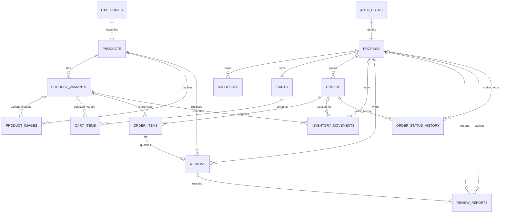

# 4. ERD — MOVEN

Sơ đồ dưới đây thể hiện các bảng nghiệp vụ của MVP. `auth.users` là bảng do Supabase Auth quản lý, không phải bảng do ứng dụng tự tạo. Đây là ERD logic; kiểu dữ liệu và các ràng buộc chi tiết xem `DATABASE_SPEC.md`.

## Bảng quan hệ chính
| Quan hệ | Bội số | Ý nghĩa |
|---|---|---|
| `auth.users` → `profiles` | 1:1 | Hồ sơ ứng dụng tương ứng tài khoản Supabase Auth |
| `categories` → `products` | 1:N | Mỗi sản phẩm thuộc đúng một danh mục chính |
| `products` → `product_variants` | 1:N | Mỗi sản phẩm có một hoặc nhiều biến thể bán được |
| `products` → `product_images` | 1:N | Ảnh chung hoặc ảnh liên quan biến thể |
| `profiles` → `addresses` | 1:N | Mỗi khách có thể lưu nhiều địa chỉ |
| `profiles` → `carts` | 1:0..1 | Một giỏ hoạt động mỗi tài khoản |
| `carts` → `cart_items` | 1:N | Các dòng giỏ |
| `profiles` → `orders` | 1:N | Một khách có nhiều đơn |
| `orders` → `order_items` | 1:N | Đơn lưu snapshot các dòng hàng |
| `orders` → `order_status_history` | 1:N | Nhật ký lịch sử chuyển trạng thái đơn qua RPC |
| `product_variants` → `inventory_movements` | 1:N | Nhật ký trừ/cộng/điều chỉnh tồn |
| `products` → `reviews` | 1:N | Một sản phẩm có nhiều đánh giá |
| `reviews` → `review_reports` | 1:N | Một đánh giá có thể bị báo cáo nhiều lần |

## Các quan hệ không thể hiện đầy đủ bằng đường nối
- `order_items` có `variant_id` nullable nhằm bảo toàn lịch sử nếu biến thể bị lưu trữ.
- `reviews.order_item_id` phải trỏ tới dòng hàng thuộc đơn đã giao thành công của chính người đánh giá và sản phẩm phải khớp. Ngoài FK, cần kiểm tra nghiệp vụ phía server.
- `store_settings` là bảng singleton về mặt nghiệp vụ; chỉ một cấu hình được dùng làm cấu hình hiện hành.
- `banners` độc lập với catalog; `link_type/link_value` là liên kết điều hướng tùy chọn, cần validation an toàn.
- `orders.shipping_address` là snapshot dạng cấu trúc hoặc JSON được chuẩn hóa theo quy ước; không phải FK tới địa chỉ hiện tại của khách.
- ERD không mô tả các bảng hệ thống do Supabase quản lý như `auth.users`, `storage.objects` đầy đủ.
